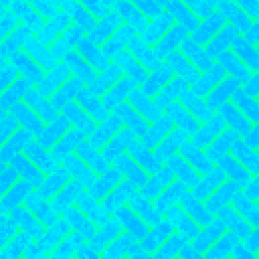
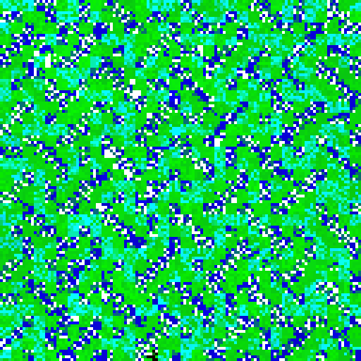

# BCPack BC1 — twelve interleaved lanes, and a decode that is a texture

The title's texture stores compress BC1 blocks with BCPack, a rANS layer that no public tool
decoded. `tools/bcpack-bc1` — in the lab tree, not this repository — is our standalone decoder: the
MDU entropy layer, the twelve-lane feeder that turns a shipped chunk into twelve symbol streams, and
the BC1 block layer. It decodes real chunks from the retail stores, and with the retail encoder's
fitted tables the output scores as a texture rather than as noise.

Read-only with respect to the store: chunks were opened and read, nothing was written back, and no
game bytes are in this repository. The decoder is **off by default and not yet wired into the
runtime**.

## 1. What a BCPack BC1 chunk is

A `.ttpf` store is a chunk table: entry `i` runs to entry `i + 1`, `file offset = (a & 0xFFFFFF) << 8`,
`codec = (a >> 24) & 0x3C`, trailing pad `= b >> 20`, `virtual length = voff[i+1] - voff[i]`. Codec
`0x04` is BC1 BCPack. The chunk's stored span minus its pad is its entropy payload; the virtual
length divided by 8 is its BC1 block count.

**Twelve lanes over one byte stream.** A chunk is not one rANS stream. It is twelve independent MDU
rANS decoders sharing a byte stream, one per BC1 field group, with per-lane alphabet widths
`7, 7, 4, 5, 4, 4, 5, 4, 7, 7, 7, 7` (`alphabet_bits`); each fragment's `z` narrows its lane's
effective width to `alphabet_bits - z`.

**Per-fragment header.** One byte per lane per fragment:

| Bits | Field | Meaning |
|---|---|---|
| 7:6 | `z` | narrows the alphabet group; `eab = min(alphabet_bits - z, 9)` |
| 5 | `hdr3` | 3-byte header instead of 2 |
| 4 | `flush_per_frag` | reset the rANS state at the fragment boundary |
| 3:0 | `q` | distribution row, 0–15, **in-band per lane per fragment** |

The body length follows `hdr3`, not `z`: with `hdr3 = 0` the header is 2 bytes and the body is
`b1 + 1` (1–256); with `hdr3 = 1` it is 3 bytes and `(b2 << 8 | b1) + 257` (257–65 792). The
`z:2 | hdr3:3 | flush:1 | q:2` reading is falsified — `hdr3` is a one-bit register, and the observed
mode bytes carry five distinct `q` rows that the 2-bit reading folds into two.

**The feeder.** Per clock: a lane holding a symbol releases it to its output slot and renormalises; a
lane that wants a byte requests one. Requests are served in lane order `0..11`, **at most 8 bytes
per clock**. One output slot per lane, all slots released together, so a release is always one
8-byte BC1 block. A lane ends in `L`, `L >> 8` or `L >> 16` — all three are legal; the compressor
drops trailing zero bytes, which is why the trimmed states must be accepted.

**Twelve symbols per block.**

| Lane | Width | Role |
|---|---|---|
| 0 | 8 | back-reference, `d = unzigzag(v) mod 256` |
| 1 | 8 | unused — decodes to zeros on every vector, which no permuted lane order reproduces |
| 2–7 | 5,6,5,5,6,5 | zigzag residuals of R0 G0 B0 R1 G1 B1 |
| 8–11 | 8 | 2×2 quadrant index codebook, quadrants at `(0,0) (2,0) (0,2) (2,2)` |

Block `i` predicts endpoints from block `i - d`; `d = 0` predicts zero, `d > i` reads slot
`(i - d) mod 256` of a fixed 256-slot preset window. Block count is a container fact, not stream
data — the decoder takes it from the container, or infers "the largest count every lane can be
paid" and then validates that guess against the legal end states and the zero pad.

## 2. What we built

The crate is dependency-free Rust — no crates, no vendored binaries.

| File | Contents |
|---|---|
| `src/lib.rs` | single-lane rANS decoder and a reference encoder (test scaffolding) |
| `src/lanes.rs` | the twelve-lane feeder, serve window, lockstep release, end-state handling |
| `src/table_groups.rs` | all nine `[eab][q][seg]` model groups, generated from the published Verilog |
| `src/blocks.rs` | twelve symbols → one BC1 block; reference chain and preset window |
| `src/chunk.rs` | fragment header, whole-chunk entry points, block-count inference |
| `src/tex.rs` | Gfx10 tiling, BC1 palette modes, box downsample, PNG writer |
| `src/table_bc1_fitted.rs` | the two retail tables, baked in by `tools/gen_fitted.py` |
| `tests/real_vectors.rs`, `tests/fitted_tables.rs` | retail chunks and texture-level checks, `#[ignore]`d |

**64 tests, 0 failures**: 57 unit tests (`cargo test --offline`) plus 4 retail-vector and 3
fitted-table tests that need the store. The unit set covers every one of the nine groups inverting
over all 65,536 slots per `q`, fragments encoded at 5/6/8/9 bits and decoded through the clocked
machine, `z` narrowing in-band, 2- and 3-byte headers with and without flush, multi-fragment lanes,
the three legal end states, and 2 000 garbage payloads ending in clean named errors without a panic.

Four retail chunks decode, all twelve lanes converging on every one:

| Store | Chunk | Blocks | Stored | Pad | Consumed | = stored − pad |
|---|---|---|---|---|---|---|
| `data/ttdb/graphics/ttdb_graphics.ttpf` | 500 | 1,536 | 8,192 | 544 | 7,648 | yes |
| `data/ttdb/terrain/ttdb_terrain_2_7.ttpf` | 42 | 1,536 | 8,192 | 86 | 8,106 | yes |
| `data/ttdb/terrain/ttdb_terrain_2_7.ttpf` | 3 | 32,768 | 167,680 | 234 | 167,446 | yes |
| `pack/story000/data/ttdb/terrain/ttdb_terrain_image_based.ttpf` | 1 | 1,024 | 5,376 | 106 | 5,270 | yes |

Per vector: every lane emits exactly `blocks` symbols (12 × 1,536 = 18,432; 12 × 32,768 = 393,216);
every lane ends in a legal state; the bytes consumed equal the stored length minus the chunk table's
pad, to the last byte; and lane 1 is all zeros. That combination pins the lane widths, the lane
order, the serve rule and the byte schedule together. The 32,768-block chunk is the heaviest case —
3-byte headers, 44 fragment headers across the lanes, up to twelve fragments on one lane.

The block count is exact against the container on all four. That is **not** the same as a byte
comparison with a reference decoder, which is still open (§5).

## 3. The verification that matters: the decode is a texture

Chunk 500 is a whole **128×128** BC1 texture: 1,536 blocks = 12,288 B, which is the only
4 KiB/64 KiB-swizzled BC1 chain of that size — a 4 KiB mip tail holding mips 1–6 and 8 KiB of mip 0.
The mip count is not pinned by size (the tail block is padded, so 4–8 mips all total 12,288), but
mips 0 and 1 land in the same place either way, and the check below needs only those two. The mip
chain is therefore a free correctness test: decode mip 0, box-filter it down by two, and compare it
with mip 1 decoded from its own blocks. Same chunk, same symbols — only the tables differ.

| Mapping | Mip-consistency PSNR | Mean \|gradient\|, mip 0 |
|---|---|---|
| `Mapping::fitted()` | **32.69 dB** | 6.38 |
| `Mapping::stub()` | 9.05 dB | 46.71 |
| fitted, one window slot zeroed | 10.38 dB | — |

The ablation is the load-bearing part: chunk 500's block 0 references **slot 121 at distance 167**,
and zeroing that single six-number slot returns the image to noise. Six numbers, one slot, 22 dB.



A coherent cyan/green herringbone weave with regular diagonal hatching, soft shading and clean block
boundaries — a fabric or carbon-fibre normal/albedo map. The same chunk with the placeholder tables:



Independent corroboration from the index statistics: the codebook's uniform symbols 0–3 account for
1,225 of 6,144 group symbols (19.9 %) against a 1.6 % chance baseline, and the top symbols after
those four are 196, 191, 194, 186, 58, 59 — mirror pairs, as the codebook's ordering implies.

On chunks with no prestart reference the endpoint layer is stream-driven and can be checked without
the window at all: three terrain chunks show 0 blocks on an unfitted slot, and mean `|dc0|` to the
previous block of 35.4 / 38.1 / 54.5 against shuffled controls of 122.2 / 52.2 / 107.7.

## 4. Where the two tables come from

The preset window (`data/bc1_window.json`: 256 slots, 254 fitted, slots 0 and 4 never referenced) and
the quadrant codebook (`data/bc1_quad_table.json`: a 256-entry bijection over all 4⁴ 2×2 patterns,
248/256 agreement between two independent upstream fits) are **`Ahmet-Dedeler/bcpack-rs`'s public
data, MIT OR Apache-2.0**. We did not derive them. `tools/gen_fitted.py` bakes them into
`src/table_bc1_fitted.rs`, checking the slot widths against `alphabet_bits` and the codebook's
bijection, and embedding the SHA-256 of both inputs (`c178ebcb…6a255cfd4962` for the window,
`3247b59a…f0ce40b2446a8d` for the codebook) so the pinned bytes are auditable. `Mapping::stub()`
remains as the documented placeholder: a zero window and a bijective codebook that keeps only the
four entries knowable without fitting.

The tables are load-bearing and **not replaceable by fitting one chunk**. Coordinate descent on the
same PSNR objective, from zeros, fits chunk 500's slot 121 to 32.6852 dB against upstream's
32.6878 dB — but on `[1, 62, 9, 1, 62, 8]` instead of the true `[31, 62, 30, 31, 61, 29]`, with only
2 of 6 fields within 2 of the truth. The objective is right and the value is real, but a single image
does not identify a slot: upstream fitted 2.1 M blocks across 256 textures. The codebook is worse —
a 256-entry bijection is under-determined by any single image. Hence: fetch, do not re-derive.

The entropy layer is table-independent, so a better table cannot invalidate it; only the block layer
moves.

## 5. Limits

1. **One chunk is one point.** 32.69 dB is a single 128×128 texture, against upstream's 35.4 dB
   median over 5,162 chunks and a plain-BC1 ceiling of 37.9 dB. It is not a distribution.
2. **No byte diff against a reference decoder.** The one rung still open: 12,288 output bytes, or the
   twelve 1,536-symbol streams, diffed against `bcpack-rs` on the same stored bytes. Convergence is
   strong but it is not the same statement as a byte-exact match, and the doc does not claim it.
3. **One geometry is inferred, not read.** Chunk 500's 128×128 shape comes from the only tiling layout
   whose chain fits that size and which scores on mip consistency; no container descriptor covers that
   offset. A scan of chunks that do carry one would remove the last inferred input.
4. **The decoder is off by default and not wired into the runtime.** Nothing in the shipped path calls
   it. The suggested switch mirrors an existing experimental flag, with the mip-consistency number
   logged per texture so a regression is visible.
5. **BC1 only.** BC3/4/5/6H/7 chunks in the same stores are untouched. The feeder is generic over lane
   count and widths, so the entropy layer should carry over, but nothing here tests it.
6. **Four chunks decoded.** Upstream reports 5,162/5,162 over a 97.9 M-block scan; this crate has been
   run on four.

## 6. Scale: this is the main texture path

BC1 BCPack is not a corner case — **102,735 chunks across 52 of the 57 texture stores**, twenty
times the next largest codec population:

| Codec | Format | Chunks |
|---|---|---|
| `0x04` | **BC1 BCPack** | **102,735** |
| `0x0C` | BC3 | 35 |
| `0x10` | BC4 | 77 |
| `0x14` | BC5 | 334 |
| `0x18` | BC6H | 268 |
| `0x1C` | BC7 | 5,167 |

The remaining five stores are zlib/stored only. The heaviest store carries 6,725 BC1 chunks of 25,371.
A whole-store scan scored by mip consistency is the obvious next measurement: it converts one point
into a distribution and costs a loop, not new format work.

## Reproducing

```powershell
cd tools\bcpack-bc1
cargo test --offline                       # 57 unit tests
$env:BCPACK_BC1_GAME_ROOT = '<store root>'
cargo test --release --offline --test real_vectors -- --ignored --nocapture
cargo test --release --offline --test fitted_tables -- --ignored --nocapture
cargo run --offline --release -- --chunk chunk.bin 1536   # per-lane budgets and end states
```

`bytes` must be exactly the stored chunk, zero pad included and nothing beyond it: the byte budget is
one of the checks, and non-zero bytes after the last consumed one are refused.

## Provenance

The one-lane entropy layer is a transcription of Microsoft's published `mdu_minirans.v` (MIT). The
twelve-lane feeder and the lockstep release rule are not in that Verilog; they are a port of
`Ahmet-Dedeler/bcpack-rs` `src/rans.rs` (MIT OR Apache-2.0), which established them on retail data.
Both are credited in the module headers and in `tools/bcpack-bc1/README.md`, as their licences
require. The images above are renders of our own decoder output.
